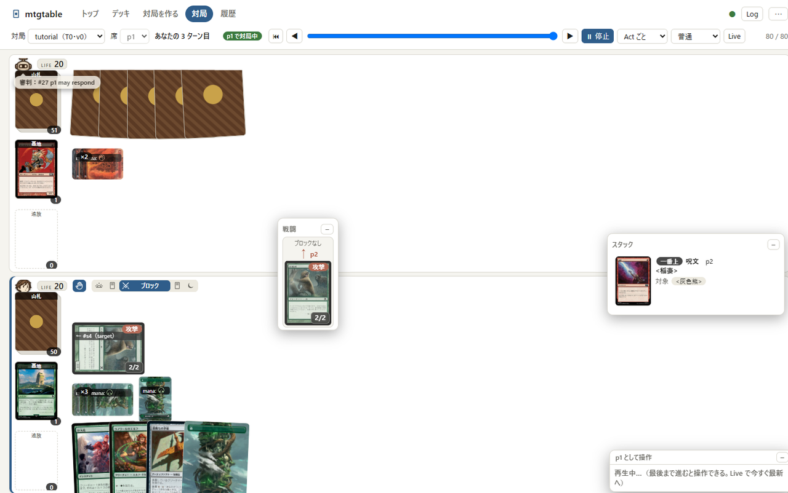
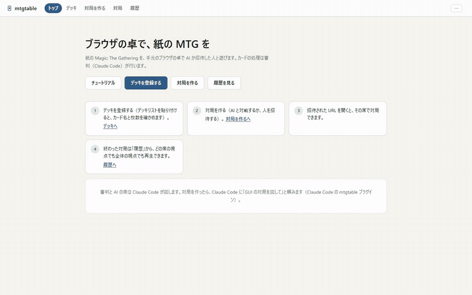
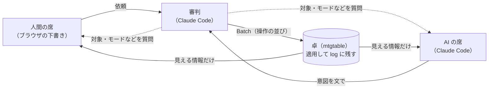

<h1 align="center">mtgtable</h1>

<p align="center">
  <b>ブラウザの卓で、紙の MTG を。</b><br>
  審判と対戦相手は Claude Code。手元のブラウザで、AI とも招待した人とも遊べるデジタル卓
</p>

<p align="center">
  <a href="README.md">English</a> · <b>日本語</b>
</p>

<p align="center">
   に相手が <稲妻> を唱え、スタックと戦闘の窓が開いている" width="860">
</p>

<p align="center">
  <br>
  <sub>10秒の紹介（チュートリアルの1局）· <a href="docs/media/demo-ja.mp4">MP4 で見る</a></sub>
</p>

mtgtable は、紙の Magic: The Gathering をそのまま卓に載せたものです。カード・カウンター・メモ・宣言といった卓上の道具だけを
用意し、**ルールの判断は審判（Claude Code）が行います**。呪文を唱えられるか、対象が適正か、誘発・置換・状況起因処理・
戦闘ダメージの扱いまで、紙の卓でジャッジがするように審判が決めて盤面を動かします。だから、どのカードもカードごとの実装を
待たずに使えます。

- **AI と対戦**: 自分のデッキを登録して、Claude Code が回す AI の席と対局する
- **人と対戦**: 1回だけ使える招待の URL で友だちを呼ぶ（審判はここでも Claude Code）
- **AI 同士の対戦テスト・一人回し**: チャットで頼むだけで、デッキを何局でも回して報告させる
- **再生**: 終わった対局は、どの時点にも戻れる時系列で、全体や両方の席の視点から見返せる
- 日本語と英語の画面。手元の1台で動き、アカウントは要らない

## 入れる（Claude Code のプラグイン）

審判と AI の席は Claude Code が回すので、mtgtable は Claude Code のプラグインとして入れます。

1. 用意するもの: [Claude Code](https://claude.com/claude-code)。ほかに足りないもの（Python など）があれば、初回に
   Claude Code が案内するので、それに従ってください
2. Claude Code にこう頼む

   ```text
   マーケットプレイス tet550/tcg-table から、プラグイン mtgtable@tcg-table を入れて
   ```

   ターミナルから入れることもできます

   ```bash
   claude plugin marketplace add tet550/tcg-table
   ```

   ```bash
   claude plugin install mtgtable@tcg-table
   ```

3. 新しい Claude Code のセッションを開き（どのフォルダでもかまいません）、「mtgtable の使い方を教えて」と頼む。
   プラグインは、入れた後に開いたセッションから使えます

mtgtable 本体（Python）は、プラグインの `mtgtable` コマンドが初回にプラグインと同じ版を GitHub から入れます（十数秒）。

> [!TIP]
> デスクトップアプリだけを入れた Windows で `claude` が無いときは、アプリに同梱の
> `%APPDATA%\Claude\claude-code\<版>\<id>\claude.exe` で同じコマンドを実行します。

**更新**: `claude plugin marketplace update tcg-table` の後 `claude plugin update mtgtable@tcg-table`。新しい mtgtable は、次に
`mtgtable` を使ったときに入ります。

## 使い方

ふだんは Claude Code に言葉で頼むだけです。コマンドを覚える必要はありません。

| やりたいこと | Claude Code への頼み方（例） |
|---|---|
| 始める・操作を覚える | 「mtgtable の使い方を教えて」 |
| 画面で AI と対戦する | 「GUI の対局を回して」 |
| AI 同士で対戦テスト | 「jund-sacrifice と piza で AI 同士の対戦テストを3局」 |
| 一人回し | 「piza を一人回しして、何ターン目にコンボが揃うか見て」 |

### 1. サイトを開いてチュートリアルをする

「mtgtable の使い方を教えて」と頼むと、Claude Code が手元のサイト（http://127.0.0.1:8765/）を起動して開きます。
トップの **チュートリアル** で、決まった台本の1局を操作しながら覚えます（約10分）。次に押すカード・メニュー・ボタンが光るので、
それに従えば、キープ・土地・唱えて解決・ターン終了・ブロック・審判の質問への回答・攻撃・相手の呪文への対応まで一通り触れます。
チュートリアルの審判と相手は台本で動くので、この間 Claude Code は何もしません。最後に「このまま続ける」を選ぶと、
そのままふつうの対局になります。

### 2. デッキを登録する

**デッキ** の画面にデッキリスト（`4 Lightning Bolt` の形。MTG Arena の書き出しもそのまま貼れます）を貼って登録します。
カード名は Scryfall で確かめ、枚数・同名カードの上限・フォーマットで使えるかを検査し、通ったものだけを保存します。
プレイ方針（任意）を書いておくと、そのデッキを使う AI がそれを読んで回します。

同梱のデッキもすぐ使えます: `piza`・`jund-sacrifice`・`boros-dwarves`・`boros-tokens`・`azorius-jace`・`mono-green-landfall`・
`orzhov-lifegain`・`rakdos-lizard`・`sultai-reanimator`（[decklists/](decklists/)）。

### 3. AI と対戦する

**対局を作る** で自分のデッキと AI のデッキを選んで対局を作り、Claude Code に「GUI の対局を回して」と頼みます。
Claude Code が審判と AI の席を受け持つエージェントを起動し、あなたの番を待ちながら決着まで回します。

盤面での操作は **審判への依頼** です。

- カードや束を押したメニューで「土地として出す」「唱える」「攻撃する」…を選ぶと、操作パネルの**下書き**に行が増えます。
  送るまで盤面は変わりません
- 下書きを **審判に依頼** で送ると、審判がルールを確かめて盤面を動かします。マナの支払い・誘発・解決は審判の仕事です
- 対象やモードなど決まっていない選択は、審判が選択肢つきで聞いてきます
- 相手が対応すると、残りの計画は下書きに戻るので、直してから送り直せます

### 4. 人と対戦する

**対局を作る** で招待を選ぶと、1回だけ使える招待の URL ができます（3日で切れます）。相手はデッキを貼るか同梱のデッキを選んで
席に着くだけで、アカウントは要りません。別の PC から入ってもらうには `mtgtable serve --host 0.0.0.0` で待ち受けます
（通信は暗号化されないので、信頼できるネットワークで使ってください）。人どうしの対局でも、審判は Claude Code が回します。

### 5. 履歴で見返す

**履歴** に対局の一覧（結果・ターン数）が並びます。終わった対局は **再生** で、全体（審判の視点）と両方の席の視点から、
どの時点にも戻って見返せます。

### 6. チャットで対戦テストをする

画面を使わずに、デッキの調整のための対局を Claude Code に回してもらえます。「AI 同士で」「一人回し」「ゴールドフィッシュ」
などと頼むと、Claude Code が両方の Player を順に担当し、CLI で卓を動かして結果を報告します。各 Player は自分に見えている
情報だけで判断します。対局の記録は作業フォルダの `playtest/` に残り、`mtgtable log` や `mtgtable view` で後から確かめられます。

## しくみ

### Rules Engine ではなく Table Engine

エンジンが持つのは、紙の卓にあるものと、それを動かす操作だけです（カードを動かす・タップする・カウンターを置く・
メモを貼る・宣言する…）。オラクルの文を読んで判定することはしません。判断はすべて AI（審判と各 Player）が行います。



- **席は盤面を直接動かせない**。書けるのは依頼・回答と、盤面を変えない宣言（キープ・パス・投了・発言）だけ。動かすのは審判だけ
- **Act と Batch**: Act はルール上一体の処理（呪文を唱える、解決する…）で、丸ごと適用するか丸ごと戻す。Batch は Act の並びで、
  止まるのは失敗と前提不成立のときだけ
- **記録と再現**: すべての Act を log に残す。乱数は seed から決まるので、同じ seed と log からいつでも同じ状態に戻せる
  （Undo・Redo・再生はこれで行う）
- **見える情報**: 各 Player に渡すのは、その Player が知り得る情報（PlayerView）だけ。AI の席に相手の手札は見せない
- **保存**: 手元のサイトの対局は SQLite（`data/site.sqlite`）。CLI では対局ごとのフォルダにも置ける
- **カード情報**: Scryfall から取り、手元にキャッシュする（リポジトリには入れない）
- **サイト**: Python の標準ライブラリだけで動くサーバーと、ビルド不要の ES modules。ホストになれるのは手元のブラウザだけ

### 構成

| 場所 | 中身 |
|---|---|
| `mtgtable/model.py`・`info.py`・`operations.py`・`engine.py`・`procedures.py` | 卓のモデル・見える情報・基本操作・Act と Batch・手順（ターンの始まりと終わり） |
| `mtgtable/store.py`・`sqlstore.py` | log・Undo/Redo・Replay（フォルダと SQLite の2つの保存先） |
| `mtgtable/cli.py`・`render.py` | コマンドラインとテキスト表示 |
| `mtgtable/web.py`・`web/` | 手元のサイト（デッキ・対局を作る・卓・履歴） |
| `mtgtable/play.py`・`lobby.py`・`decks.py`・`history.py`・`tutorial.py` | 席の書き込み・対局の作成と招待・デッキの検査・履歴・チュートリアル |
| `mtgtable/prompt.py`・`prompts/` | 審判と AI の席のプロンプトの書き出しと、返答の適用 |
| `mtgtable/carddb.py` | オラクルのキャッシュ（Scryfall） |
| `plugins/mtgtable/` | Claude Code のプラグイン（`mtgtable` コマンド・スキル `mtg-playtest`・エージェント `mtg-table`） |
| `decklists/` | 同梱のデッキと戦略メモ |
| `design/` | 設計書（[basic_design.md](design/basic_design.md) から） |

CLI・Batch・Operation の書き方の正本はスキルのリファレンス
[references/cli.md](plugins/mtgtable/skills/mtg-playtest/references/cli.md) です。

## 開発

clone したフォルダでは、プラグインの `mtgtable` コマンドがそのフォルダのパッケージを動かします（Python の変更はそのまま効きます）。
Python 3.10 以上、標準ライブラリのみ。

```bash
python -m mtgtable serve
```

```bash
python -m mtgtable new playtest/g1 --deck p1=piza --deck p2=jund-sacrifice --seed 1
```

- **スキル・エージェントの変更を試す**: マーケットプレイスをこのフォルダに向けて入れ直す（戻すときは `tet550/tcg-table` を足す）

  ```bash
  claude plugin marketplace remove tcg-table && claude plugin marketplace add ./ && claude plugin install mtgtable@tcg-table
  ```

- **プラグインを使わずに CLI だけ使う**: `uvx --from git+https://github.com/tet550/tcg-table@v0.1.10 mtgtable --help`
- **置き場所**: カードのキャッシュとサイトの DB は、リポジトリからならリポジトリ直下（`cards/`・`data/`）、パッケージとして入れたなら
  OS のデータ用フォルダ。`MTGTABLE_HOME` でまとめて変えられます
- **Windows**: `python` が無ければ `py -3` に読み替えます。PowerShell では `$env:PYTHONIOENCODING = 'utf-8'` を設定してから実行します
- **リリース**: `mtgtable/__init__.py` の `__version__` と `plugins/mtgtable/.claude-plugin/plugin.json` の `version` をそろえて
  コミットし、タグ `v<版>` を付けて push します（利用者の mtgtable はこのタグから入ります）
- **テスト**: 重要な機能と不変の仕様だけを確かめる最小限のもの（決まりは [CLAUDE.md](CLAUDE.md)）

  ```bash
  python -m unittest discover -s tests
  ```

  ```bash
  node --test tests/web.test.mjs
  ```

### まだ無いもの

- 外に公開するサーバーとしての運用（HTTPS・利用者の識別）
- LLM の API（自分のキー）で審判と AI の席を回す経路（今は Claude Code だけ）
- 対局の公開と、対局記録の集計

## 権利

MIT License（[LICENSE](LICENSE)）。対象はこのリポジトリで書いたコードと文書だけです。

mtgtable は Wizards of the Coast の [Fan Content Policy](https://company.wizards.com/en/legal/fancontentpolicy) に基づく非公式のファン
コンテンツで、Wizards of the Coast による承認・支援は受けていません。Magic: The Gathering のカード名・カードテキスト・アートの権利は
Wizards of the Coast LLC に帰属します。カード情報と画像は [Scryfall](https://scryfall.com/) から取得しています。詳しくは
[NOTICE.md](NOTICE.md) を参照してください。
