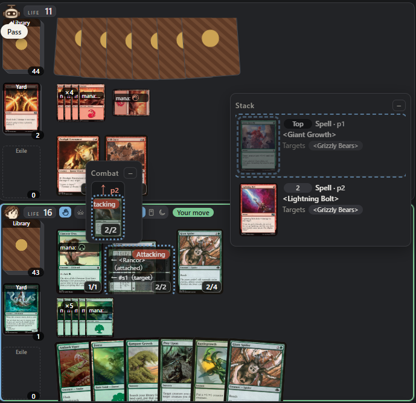
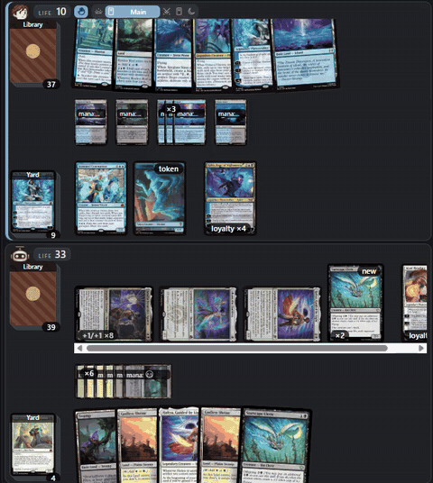
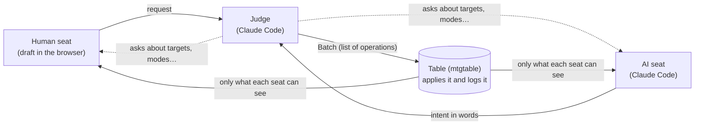

<h1 align="center">mtgtable</h1>

<p align="center">
  <b>Paper MTG, on a table in your browser.</b><br>
  A digital tabletop where Claude Code is the judge and your opponent. Play an AI or a friend, right on your machine.
</p>

<p align="center">
  <b>English</b> · <a href="README.ja.md">日本語</a>
</p>

<p align="center">
  
</p>

<p align="center">
  <br>
  <sub>A 10-second tour (replay of a game, 2× speed) · <a href="docs/media/demo.mp4">Watch as MP4</a></sub>
</p>

mtgtable puts paper Magic: The Gathering on a digital table. It provides only the things on a real table (cards, counters,
notes, declarations) and **leaves every rules decision to the judge, Claude Code**. Whether a spell can be cast, whether a
target is legal, how triggers, replacement effects, state-based actions and combat damage work out: the judge decides and
moves the board, the way a judge would at a paper table. That is why any card works without being implemented one by one.

- **Play an AI**: register your deck and play against an AI seat run by Claude Code
- **Play a friend**: send a single-use invitation URL (Claude Code is still the judge)
- **Playtest in chat**: AI vs AI games and goldfishing, as many games as you like, with a report at the end
- **Replay**: step through finished games to any point, from the whole table or either seat
- English and Japanese UI. Runs on your own machine, no account needed

## Install (Claude Code plugin)

Claude Code runs the judge and the AI seats, so mtgtable is installed as a Claude Code plugin.

1. You need [Claude Code](https://claude.com/claude-code). If anything else is missing (such as Python), Claude Code tells
   you on first use; just follow its guidance
2. Ask Claude Code:

   ```text
   Install the plugin mtgtable@tcg-table from the marketplace tet550/tcg-table
   ```

   You can also install it from a terminal:

   ```bash
   claude plugin marketplace add tet550/tcg-table
   ```

   ```bash
   claude plugin install mtgtable@tcg-table
   ```

3. Open a new Claude Code session (in any folder) and ask "How do I use mtgtable?". The plugin is available in sessions
   opened after it's installed

On first use, the plugin's `mtgtable` command installs the matching version of mtgtable (Python) from GitHub (takes a few seconds).

> [!TIP]
> On Windows with only the desktop app installed, `claude` may not be on your PATH. Run the same commands with the bundled
> `%APPDATA%\Claude\claude-code\<version>\<id>\claude.exe`.

**Update**: `claude plugin marketplace update tcg-table`, then `claude plugin update mtgtable@tcg-table`. The new mtgtable is
installed the next time `mtgtable` runs.

## Usage

Just ask Claude Code in plain words. There are no commands to learn.

| You want to | Ask Claude Code (example) |
|---|---|
| Get started and learn the controls | "How do I use mtgtable?" |
| Play an AI in the browser | "Run the GUI game" |
| Playtest AI vs AI | "Playtest jund-sacrifice vs piza, AI vs AI, 3 games" |
| Goldfish | "Goldfish piza and tell me which turn the combo comes together" |

### 1. Open the site and do the tutorial

Ask "How do I use mtgtable?" and Claude Code starts the local site (http://127.0.0.1:8765/) and opens it. Click **Tutorial**
on the home page to learn by playing a scripted game (about 10 minutes). The next card, menu item or button to press
lights up, and along the way you keep a hand, play lands, cast and resolve spells, end turns, block, answer the judge,
attack, and respond to an opponent's spell. The judge and opponent in the tutorial follow a script, so Claude Code isn't
needed. At the end, **Keep playing** turns it into a regular game.

### 2. Register a deck

On the **Decks** page, paste a decklist (`4 Lightning Bolt` lines; an MTG Arena export works as is). Card names are checked
against Scryfall, along with deck size, copy limits and format legality, and only decks that pass are saved. An optional
play plan is read by the AI that pilots the deck.

Bundled decks are ready to use: `piza`, `jund-sacrifice`, `boros-dwarves`, `boros-tokens`, `azorius-jace`,
`mono-green-landfall`, `orzhov-lifegain`, `rakdos-lizard`, `sultai-reanimator` ([decklists/](decklists/)).

### 3. Play an AI

On **New game**, pick your deck and the AI's deck, then ask Claude Code to "run the GUI game". Claude Code starts an agent
that acts as the judge and the AI seat, waits for your moves, and plays the game to the end.

On the board, every move is **a request to the judge**:

- Pick an action from a card or pile's menu (play as land, cast, attack…) and it's added to the **draft** in the play panel.
  Nothing changes on the board until you send it
- **Send to the judge**, and the judge checks the rules and moves the board. Paying mana, triggers and resolving are the judge's job
- Choices that aren't settled yet (targets, modes…) come back as a question with options
- If the opponent responds, the rest of your plan returns to the draft so you can adjust it and send it again

### 4. Play a friend

Choose an invitation on **New game** to get a single-use URL (it expires in 3 days). Your friend pastes a decklist or picks a
bundled deck and takes the seat, no account needed. To let them join from another PC, listen with
`mtgtable serve --host 0.0.0.0` (traffic is not encrypted, so use a network you trust). Claude Code is the judge here too.

### 5. Look back in History

**History** lists your games with results and turn counts. **Replay** a finished game from the judge's view or either seat,
and jump to any point in it.

### 6. Playtest in chat

You can also have Claude Code play games for deck tuning, without the browser. Ask for "AI vs AI", "goldfish" and so on:
Claude Code plays both players in turn, moves the table through the CLI, and reports the results. Each player decides only
from what that player can see. Games are kept under `playtest/` in your working folder, and you can check them later with
`mtgtable log` or `mtgtable view`.

## How it works

### A table engine, not a rules engine

The engine has only what a paper table has and the operations that move it (move a card, tap, add a counter, attach a note,
declare…). It never reads Oracle text to decide anything. Every judgment is made by the AI: the judge and each player.



- **Seats can't move the board.** They can only write requests, answers, and declarations that don't change the board
  (keep, pass, concede, chat). Only the judge moves the board
- **Acts and Batches**: an Act is one rules-level unit (casting a spell, resolving it…), applied or undone as a whole. A Batch
  is a list of Acts and stops only on a failure or an unmet precondition
- **Record and replay**: every Act is logged. Randomness comes from the seed, so the same seed and log always rebuild the same
  state (undo, redo and replay all work this way)
- **Hidden information**: each player gets only what they could know (a PlayerView). The AI seat never sees your hand
- **Storage**: games on the local site live in SQLite (`data/site.sqlite`). The CLI can also keep a game in its own folder
- **Card data**: fetched from Scryfall and cached locally (not in the repository)
- **Site**: a server built on Python's standard library and build-free ES modules. Only the browser on your machine can be the host

### Layout

| Path | What's there |
|---|---|
| `mtgtable/model.py`, `info.py`, `operations.py`, `engine.py`, `procedures.py` | Table model, visible information, basic operations, Acts and Batches, procedures (turn start and end) |
| `mtgtable/store.py`, `sqlstore.py` | Log, undo/redo, replay (folder and SQLite storage) |
| `mtgtable/cli.py`, `render.py` | Command line and text rendering |
| `mtgtable/web.py`, `web/` | The local site (decks, new game, table, history) |
| `mtgtable/play.py`, `lobby.py`, `decks.py`, `history.py`, `tutorial.py` | Seat writes, game creation and invitations, deck checks, history, tutorial |
| `mtgtable/prompt.py`, `prompts/` | Prompts for the judge and AI seats, and applying their answers |
| `mtgtable/carddb.py` | Oracle cache (Scryfall) |
| `plugins/mtgtable/` | The Claude Code plugin (`mtgtable` command, `mtg-playtest` skill, `mtg-table` agent) |
| `decklists/` | Bundled decks and strategy notes |
| `design/` | Design documents (start at [basic_design.md](design/basic_design.md), in Japanese) |

The reference for the CLI, Batches and Operations is the skill's
[references/cli.md](plugins/mtgtable/skills/mtg-playtest/references/cli.md) (in Japanese).

## Development

In a clone of this repository, the plugin's `mtgtable` command runs the package from that folder, so Python changes take
effect immediately. Python 3.10+, standard library only.

```bash
python -m mtgtable serve
```

```bash
python -m mtgtable new playtest/g1 --deck p1=piza --deck p2=jund-sacrifice --seed 1
```

- **Try skill or agent changes**: point the marketplace at this folder and reinstall (add `tet550/tcg-table` again to switch back)

  ```bash
  claude plugin marketplace remove tcg-table && claude plugin marketplace add ./ && claude plugin install mtgtable@tcg-table
  ```

- **CLI only, without the plugin**: `uvx --from git+https://github.com/tet550/tcg-table@v0.1.11 mtgtable --help`
- **Where files go**: the card cache and the site DB sit at the repository root (`cards/`, `data/`) when run from the repository,
  or in the OS data folder when installed as a package. Set `MTGTABLE_HOME` to move them all
- **Windows**: use `py -3` if `python` isn't available. In PowerShell, set `$env:PYTHONIOENCODING = 'utf-8'` first
- **Release**: bump `__version__` in `mtgtable/__init__.py` and `version` in `plugins/mtgtable/.claude-plugin/plugin.json`
  together, commit, tag `v<version>` and push (users' mtgtable installs from that tag)
- **Tests**: a minimal set that checks only key features and invariants (the rules are in [CLAUDE.md](CLAUDE.md))

  ```bash
  python -m unittest discover -s tests
  ```

  ```bash
  node --test tests/web.test.mjs
  ```

### Not yet

- Running as a public server (HTTPS, user identity)
- Running the judge and AI seats through an LLM API with your own key (Claude Code only for now)
- Publishing games, and aggregate statistics over game records

## Rights

MIT License ([LICENSE](LICENSE)), covering only the code and documents written in this repository.

mtgtable is unofficial Fan Content permitted under the Wizards of the Coast
[Fan Content Policy](https://company.wizards.com/en/legal/fancontentpolicy). Not approved/endorsed by Wizards. Portions of the
materials used are property of Wizards of the Coast. ©Wizards of the Coast LLC. Card data and images come from
[Scryfall](https://scryfall.com/). See [NOTICE.md](NOTICE.md) for details.
